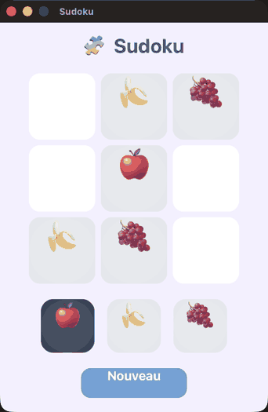

# Sudoku

**A picture sudoku for young kids.** A 3×3 grid uses three picture elements (fruits, animals,
unicorns…); fill it so **every row and every column holds all three, with no repeat** — the rule
of a Latin square, which is what a 3-symbol sudoku is. Built on
[Hero](https://github.com/mesopelagique/Hero) (`cs.hero`) for the animations.

## Play

Open the project — `On Startup` launches it.

- A few cells come **given** (greyed, locked); the rest are empty.
- Pick an element from the **palette**, then tap an empty cell to place it (tap again to clear).
- A cell that **repeats** its element in its row or column turns **red** — fix it.
- Fill the grid with no clashes → **Bravo !**
- **Nouveau** deals a fresh puzzle with a new set of pictures.

Three elements → a 3×3 grid (so each line really can hold each one once). The code is written for
a side `N`, so 4×4 with four elements, or a full 9×9, is a one-line change.

## How it's built

Each puzzle is a random **Latin square** (base `(r+c) mod N`, then the symbols, rows and columns
shuffled), with some cells revealed as clues. Placing an element pops it in with a `cs.hero`
`easeOutBack` tween; clashes are detected per row/column and painted live; a win pulses the whole
grid. No two tweens fight over one object, and the board geometry comes from the form.

## `cs.Sudoku`

| Function | Action |
|:-|:-|
| `.newPuzzle()` | Deal a new Latin square + theme, reveal the clues. |
| `.selectBrush($b)` | Pick element `$b` from the palette. |
| `.tapCell($i)` | Place the brush in cell `$i` (or clear it); re-check clashes and the win. |
